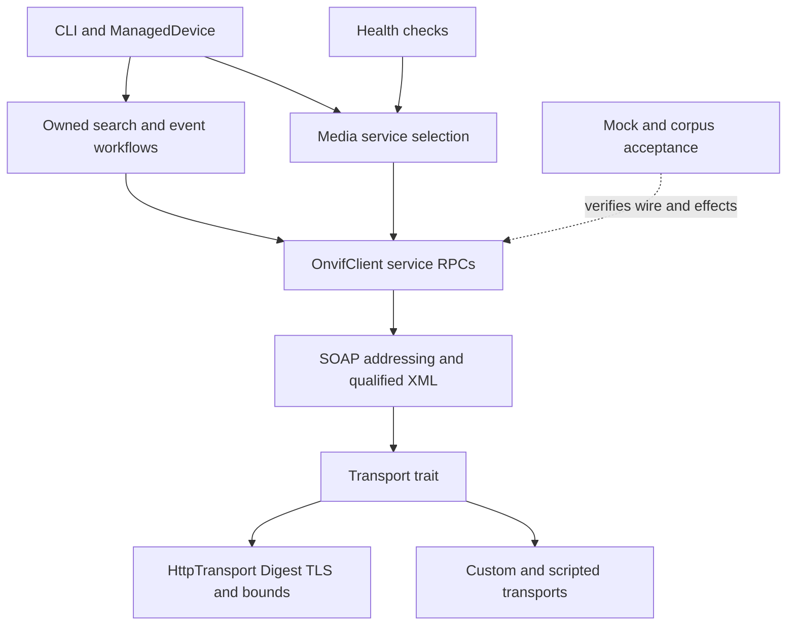

# ONVIF interoperability implementation plan

[English](onvif-interoperability-plan.md) | [繁體中文](onvif-interoperability-plan_zh.md)

I01–I10 are implemented. The [delivery evidence](#i07i10-delivery-evidence)
records local checks and the pending device cases. Source walkthrough
2026-11-11 used `d77792564f9e9032f6d41bb6614ccbda80b92eba`, workspace 0.17.1,
and the then-uncommitted HB1 candidate. HB1 and the implementation are
committed by feature. Device acceptance is deferred.

The first delivery should make recording searches finish honestly, support
endpoint references without losing XML identity, and provide managed event
subscriptions. Authentication selection and a shared Media1/Media2 read workflow
follow those foundations. Later service additions have explicit architecture and
entry criteria below; they are not all prerequisites for one release.

| Section | Purpose |
| --- | --- |
| [Ownership and baseline](#ownership-and-baseline) | Existing work to retain and scope ownership |
| [Source findings](#source-findings) | Current symbols, behaviors and test limitations |
| [Architecture](#architecture) | Layer boundaries and extension rules |
| [Delivery order](#delivery-order) | Dependencies and bounded batches |
| [First delivery](#first-delivery) | I01–I05 implementation directions |
| [Further service capabilities](#further-service-capabilities) | I06–I10 architecture before expansion |
| [Compatibility and acceptance](#compatibility-and-acceptance) | API, schemas, tests and hardware evidence |
| [Planning verification](#planning-verification) | Checks on this document change |
| [I01 delivery evidence](#i01-delivery-evidence) | Current contract, compatibility and local acceptance |
| [I02–I06 delivery evidence](#i02i06-delivery-evidence) | Contracts and verification for XML, auth, events, media and PTZ |
| [I07–I10 delivery evidence](#i07i10-delivery-evidence) | Streaming, overlays, extended services and interoperability coverage |

## Ownership and baseline

The [post-0.17 backlog](post-0.17-backlog.md) remains the programme index. This
plan owns the client-side interoperability slices I01–I10. Mock W07–W23 remain
owned by the [fidelity checklist](mock-fidelity-execution-checklist.md); tests
needed by a client slice do not close that whole programme. CLI product stages
remain with the [CLI plan](oxvif-cli-plan.md) and
[hardening plan](oxvif-cli-release-hardening-plan.md).

Retain these delivered foundations:

- [Next-version P0–P6](next-version-plan.md): bounded HTTP/XML, Session reports,
  safe traces, retry metadata, corpus verification and six-Action reference
  comparison. P5 hardware evidence remains a separate acceptance input.
- [HB1](mock-fidelity-http-binding.md): locally accepted header/status policy,
  malformed/raw fallback and refusal protection. HB1 was later committed as `b0be9ec`.
- `ManagedDevice` already caches a Session for 60 seconds and invalidates it
  after failures/credential changes. Do not introduce another CLI session cache.
- Media2 methods, service discovery, PTZ node/options types, snapshot authentication,
  replay effects and bounded event Mock lifecycle already exist. Improve their
  integration rather than scheduling them as missing services.

The initial client work belongs to F03 recording, F04 events, F05 interoperability
and F15 consumers. I05/I08 relate to F01 Media, I06 to F02 PTZ, and I07/I09 to
F08/F10 diagnostics and audio product decisions. I10 extends F14 verification.
These are cross-references, not duplicate implementation queues. The original
P0–P6 version candidate is not a version decision for this broader plan.

## Source findings

Line references describe this walkthrough; implementation should locate the
named symbol again. The findings are source observations, not measured
multi-vendor failure rates or ONVIF certification findings.

| ID | Current code and path | Finding and consequence | Existing tests or evidence |
| --- | --- | --- | --- |
| S01 | [recording.rs](../../src/client/recording.rs), `search_recordings` L400; [recording types](../../src/types/recording.rs), `FindRecordingResults` | Polling uses `await?` before cleanup; a poll failure skips `EndSearch`. Twenty rounds can return `Ok(Vec)` without Completed, and cleanup errors are discarded. The scope is always empty in `find_recordings`. | [recording tests](../../src/tests/client/recording_tests.rs) cover initial Find failure and empty Completed results; the latter serves one multi-response envelope and ignores an EndSearch mismatch. It does not prove cleanup order or incomplete handling. |
| S02 | [events.rs](../../src/client/events.rs), `event_stream` L295 and `pull_messages` L116 | The stream loops over a URL until an error; it does not own a lease, renew, reconnect or unsubscribe. PullMessages exposes notifications but discards response lease timing. | [event tests](../../src/tests/client/events_tests.rs) pin one yielded event and an expired-subscription Fault; they do not prove lease renewal or cancellation cleanup. |
| S03 | [event types](../../src/types/events.rs), `PullPointSubscription`, `NotificationMessage`, `EventProperties`; [envelope](../../src/soap/envelope.rs), `SoapEnvelope` | Pull subscription stores URL/termination only; notification stores Topic, time, operation, Source/Data maps. Key, ElementItem, namespace identity and EPR ReferenceParameters are not represented. The envelope supports To/security, without typed addressing headers. | [notification compatibility](../../tests/notification_origin.rs) pins old struct literals and JSON; changing public fields in place would break consumers. |
| S04 | [XML DOM](../../src/soap/xml.rs), `XmlNode`, `from_bytes_start`; [complete validator](../../src/soap/complete.rs) | Production syntax/resource checks exist, but the compatibility DOM strips namespace declarations and localizes names. It cannot round-trip scoped EPR or QName-valued extensions. | [XML compatibility](../../tests/xml_compat.rs) and [response bounds](../../tests/soap_response_bounds.rs) are contracts to preserve; the private Mock Request tree is not a production dependency to expose. |
| S05 | [client](../../src/client/mod.rs), `with_credentials`, `security_token`, `call`; [transport](../../src/transport.rs), `HttpTransport`, `Transport` | The default client derives Digest credentials and emits WSSE from one credential option. A custom transport owns its Digest configuration. The transport trait has one String-body method, while HTTP timeout is currently client-wide. | [builder tests](../../src/tests/client/mod_tests.rs) verify both builder orders and default-transport invalidation; HTTP tests cover TLS, Digest and deadlines. |
| S06 | [Session](../../src/session.rs), `build_with_report`, `fill_missing_service_urls`, `get_profiles` L620 / `get_profiles_media2` L940 | Both media services exist, with GetServices fallback and URL provenance. General profile/URI methods explicitly use Media1; there is no shared service-selection workflow. | [Session tests](../../src/tests/session_tests.rs) pin initialization traffic, fallback precedence, missing-service errors and report classifications. |
| S07 | [CLI application](../../crates/oxvif-cli/src/application.rs), `execute_diagnostic`, `build_http_transport`; [maintenance](../../crates/oxvif-cli/src/maintenance.rs), `ManagedDevice`, `profile_report`, `connect`, `collect_inventory` | Profile selection, diagnosis, snapshot and inventory paths use Media1 shapes. Profile details join encoder tokens correctly already. Session reuse, typed retry, native credentials and TLS roots are present. | Maintenance tests pin cache expiry, cancellation, no-clobber, identity-aware inventory diff and private-CA handling. Extend these paths together. |
| S08 | [Media1](../../src/client/media.rs), `get_stream_uri`; [Media2](../../src/client/media2.rs), `get_profiles_media2`, `get_stream_uri_media2` | Live URI setup is fixed; Media2 profiles request All. Media2 has audio output/decoder reads and metadata setters, but no Media2 OSD/privacy masks or output/decoder setters/options. | Media1/Media2 client tests, [rate control](../../tests/media2_rate_control.rs), audio/metadata and OSD suites already cover selected families. |
| S09 | [PTZ](../../src/client/ptz.rs), absolute/relative/continuous move and Stop; [PTZ types](../../src/types/ptz_config.rs), `PtzSpaceRange`, `PtzSpeed` | Move calls always emit PanTilt and Zoom; per-move space/speed/timeout and per-axis Stop are not exposed. Range parsing supplies legacy defaults for absent/malformed limits, so those defaults are not proven device bounds. | Existing PTZ tests and [profile identity](../../tests/mock_ptz_profile_identity.rs) cover routing, not every supported axis/coordinate system or physical motion. |
| S10 | [Health](../../src/health/checks.rs), `services`, `media`, `rtsp_options_probe`; [snapshot](../../src/health/snapshot.rs) | Health can force-probe Media2 service candidates, but ordinary media checks use Media1/first profile. RTSP OPTIONS 200/401 proves reachability only, with IPv4/hostname parsing; snapshot has shared URL/auth/size checks. | Preserve force-only diagnostics and existing snapshot tests; do not convert diagnostic guessed URLs into default service routing. |
| S11 | [Mock recording](../../src/mock/services/recording.rs), `resp_find_recordings`, `resp_recording_search_results`; [policy](../../src/mock/policy.rs), `SearchEnd` | Mock search uses a fixed token, whole-list Completed responses and acknowledgment-only EndSearch. It cannot be the only oracle for paging/lease cleanup. | Existing Mock tests remain useful for other contracts; initial I01 acceptance needs a scripted transport and local HTTP fixture. |
| S12 | [Mock lifecycle](../../src/mock/services/events/lifecycle.rs); [projection](../../src/metamorph/projection.rs), `projection`; [regression](../../src/metamorph/regression.rs) | EP2 already models independent event endpoints/queues/leases; reference comparison already handles DeviceInformation/Hostname and both media services' profile/encoder lists. | [event lifecycle](../../tests/mock_event_lifecycle.rs), [corpus](../../tests/corpus_regression.rs), [reference comparison](../../tests/reference_comparison.rs) supply foundations; dynamic event timing and wider projections still need separate contracts. |

Protocol review uses the [official specification index](https://www.onvif.org/profiles/specifications/),
[Media2 26.06](https://www.onvif.org/specs/srv/media/ONVIF-Media2-Service-Spec.pdf),
[Recording Search 26.06](https://www.onvif.org/specs/srv/rsrch/ONVIF-RecordingSearch-Service-Spec.pdf),
[PTZ 26.06](https://www.onvif.org/specs/srv/ptz/ONVIF-PTZ-Service-Spec.pdf) and
[WS-Addressing Core](https://www.w3.org/TR/ws-addr-core/). Reviewed conclusions:
service support is capability-dependent; EPR parameters carry scoped XML
identity; Media2 configuration and streaming transport are separate contracts.
Official XML resources stay outside the checkout; this plan records reviewed
design conclusions rather than copying schemas or generated catalogues.

## Architecture

Keep stateless service RPCs in `src/client/`, protocol representations in
`src/soap/` and `src/types/`, and owned workflows in focused domain modules.
CLI and Health consume the same library workflow; neither becomes its owner.
Create modules as their first slice needs them, without reorganizing unrelated
services or extracting crates in advance.

| Proposed boundary | Responsibility | Keep outside it |
| --- | --- | --- |
| `src/soap/addressing.rs`, `src/soap/qualified.rs` | Bounded namespace-aware fragments, EPRs, request addressing and serialization | Lease timers, vendor URL rewriting, credential persistence |
| `src/client/auth.rs` | Explicit SOAP-auth policy and default-transport credential derivation | OS keyring access and automatic security downgrade |
| `src/recording/search.rs` | Search ownership, polling budgets, completion and cleanup reports | Recording CRUD, video decode and generic job orchestration |
| `src/events/model.rs`, `src/events/subscription.rs` | Rich event model and one owned managed subscription | Unbounded broker/history, UI state and global worker registries |
| `src/media/catalog.rs`, `src/media/route.rs` | Service-qualified profile handles, configuration joins and operation selection | Decoder lifecycle and duplicate CLI session caching |
| Optional `src/streaming/` | RTSP protocol adapter, bounded probe/backchannel sessions | Default SOAP dependency graph and GUI rendering |

All new public type/API names below are design sketches. Prefer constructors
and accessors for new extensible types. Existing public struct literals, error
matches, serde forms and custom Transport implementations are compatibility
inputs, not incidental details. Do not create a universal XML operation engine,
generic background-job framework or vendor-name switchboard for these slices.

## Delivery order

| Batch | Scope and dependencies | Exit condition |
| --- | --- | --- |
| A | I01 search correctness and explicit outcomes | Poll failures clean up; incomplete results cannot masquerade as complete |
| B | I02 qualified XML/EPR, I03 auth and request budgets | Captured wire, custom transports and legacy consumers pass compatibility controls |
| C | I04 managed events, requiring B | Renewal, backpressure, recovery and shutdown pass deterministic concurrency controls |
| D | I05 shared media reads, requiring B classification | Media1-only/Media2-only and mixed-source workflows work through Library, CLI and Health |
| E | Select I06 PTZ, I07 streaming probe or I08 Media2 OSD/masks | One complete capability-driven slice with wire and effect evidence |
| F | I09 audio/analytics/recording extensions and I10 wider reference acceptance | Each feature passes its own architecture/acceptance boundary; no blanket profile claim |

I10 verification work accompanies each earlier batch. F11 discovery, device
certificate/backup management and distribution remain separate follow-ups.
No release date or implementation authorization is inferred from this order.

## First delivery

### I01 Recording search outcomes and resource ownership

S01/S11 define the first, independently useful correction. Retain direct
Find/Poll/End RPC methods. Introduce a `RecordingSearch` owner and an options/report
API with total deadline, maximum pages/items/retained bytes, wait interval and
explicit completion/stop reason. Check decoded page size before retaining it;
per-response XML limits do not replace a retained-results budget. Keep source-recording
order; do not deduplicate opaque tokens without a defined page contract.

All normal return paths after token acquisition execute one bounded cleanup
attempt, including polling/parse errors and exhausted budgets. Preserve the
primary failure; expose cleanup success/failure separately, including EndSearch's
endpoint value where available. Cleanup uses its own small budget after the
polling budget expires. Initial Find failure has no token to close. Cancellation
before a Find response can leave an unknown remote token; the remote lease is
the fallback, not a cleanup guarantee.

Provide explicit async `close`/`cancel_and_close`. Drop performs local cancellation
only and must not silently spawn a runtime task. Externally aborting a future
cannot promise remote EndSearch; document that boundary and the lease expiry.
A paused clock and per-operation captured call log establish ordering without
requiring full W14 Mock search fidelity first.

Compatibility: a new report API has a dedicated workflow error carrying partial
results and cleanup disposition. The legacy Vec helper keeps its signature but
must stop reporting a non-completed search as success. A named incomplete error
requires an explicit public-error/semver migration review; do not encode it as a
fake HTTP status or MissingField. Preserve the existing original poll error on
ordinary failure, adding cleanup detail only through the new report surface.

Acceptance: Find failure/no cleanup; poll failure/exact token cleanup; queued,
empty and multi-page results; Completed on the boundary; deadline/page/item/byte
exhaustion; unknown state; cleanup Fault/timeout; cancellation before/after token;
two independent searches. Replace the multi-response test with action-specific
scripted replies and HTTP controls. Perturb completion detection and cleanup
dispatch to prove the new guards fail.

### I02 Scoped XML and endpoint references

Add a small qualified representation that retains expanded element/attribute
names, mixed-content order and namespace bindings needed for QName values. Use
the existing complete-input validation and explicit byte/depth/node budgets;
bound extension-fragment retention too. Keep the current XmlNode API/semantics
for existing parsers. Do not depend on `mock::Request` or move the whole Mock
parser into production as an incidental refactor. Compare the existing qualified
projection implementation before sharing a proven primitive.

Model an endpoint reference as an address plus ordered, validated reference
parameters. Re-serialization must retain bindings for QName-valued content,
including shadowing; an expanded-name-only map is insufficient. ElementItem
extensions use the same bounded representation. No raw String concatenation of
server-supplied headers. Opaque fragment serialization is a wire facility,
excluded or sanitized in routine logs and CLI output.
Validate EPR/service destinations against an explicit scheme/origin policy before
forwarding credentials. Cross-origin devices need a configured trust rule; do not
silently rewrite addresses or treat an authenticated response as blanket trust
for every advertised destination. Existing caller-directed RPCs retain their
documented behavior; this is an explicit contract of the new managed APIs.

Introduce a private call builder carrying Action, destination and typed addressing
headers; service methods retain their exact Action constants. Populate EPR
parameters when calling Pull/Renew/Unsubscribe. Define each operation's addressing
requirements from Core/WS-Notification binding review before changing existing
wire output; a SOAP Content-Type action does not itself provide an EPR model.

Add new rich subscription/event types and explicit conversions to legacy types.
Keep old literal construction and JSON in `notification_origin.rs` intact. A
legacy projection can be documented as lossy; the managed API must retain Key,
ordered duplicate items, ElementItem and topic/dialect namespace identity.
Do not silently collapse rich items into HashMaps.

Acceptance: alternate/default namespaces, sibling/ancestor rebinding, two EPRs
sharing one address but different parameters, parameter order and escaping,
qualified attributes/QName values, nested decoys, duplicate/invalid structures,
retention limits, captured subsequent headers and legacy literal/serde consumers.

### I03 Authentication selection and request budgets

Keep the credential handle separate from an explicit SOAP-auth policy and
transport auth configuration. New modes cover Digest-only, WSSE-only and the
legacy combined behavior; legacy `with_credentials` remains combined. A supplied
custom transport continues to own HTTP authentication in either builder order.
Invalidate derived default clients only when their inputs change. CLI continues
using its existing native credential stores and PEM-root builder.

The [Profile S transition](https://www.onvif.org/profiles/profile-s/profile-s-deprecation-qna/)
ends new Profile S conformance submissions on 2027-03-31; existing installations
continue working. This motivates explicit selection, not removal of legacy
support or speculative profile-based authentication guesses. Clock Auto should
depend on the selected WSSE behavior; Always/Never remain explicit. Report the
selected mechanism without credentials, challenges or raw EPR headers.

Managed long-polling also needs a reviewed request-budget extension. Prefer an
additive provided Transport method accepting per-request options, with an HTTP
override applying request timeout on both plain and Digest paths. The existing
required `soap_post` stays implementable unchanged. The default extension must
enforce its outer deadline and state that an unknown custom transport may retain
a shorter inner timeout; it cannot promise to lengthen that limit. Body caps,
TLS trust and Digest credentials survive overrides. Do not simulate long-poll
support by repeatedly timing out the unchanged ten-second HTTP client.

Acceptance: all three modes on captured wire; both builder orders; custom transport
unchanged; TLS/private roots; challenge failure without downgrade; mode-aware
clock behavior; concurrent short calls and long polls; whole exchange deadline
including Digest retry; cancellation and oversized Fault bodies.

### I04 Managed event subscriptions

Build the new API on I02 EPRs/rich events and I03 budgets. Keep low-level methods
and the legacy borrowing stream. One managed owner controls one lease, worker
and bounded data queue. Use a state machine:
Creating → Active → Renewing/Recovering → Closing → Closed/Failed.
This is a client abstraction, independent of Mock EP2's device-side state.

Read CurrentTime/TerminationTime from creation, renewal and pull responses.
Translate a valid lease interval into a monotonic deadline; handle absent/invalid
times explicitly, without guessing from a skewed wall clock. The initial managed
API requires usable granted timing: otherwise return a typed timing failure and
attempt bounded cleanup of a known subscription; direct legacy calls remain
available. Use Tokio's monotonic clock so paused-time tests exercise the real
schedule. Schedule renewal
before expiry with a bounded margin. Renewal/control must progress during a
blocked long-poll or slow consumer; do not serialize everything behind one await
or hold locks across network I/O. Suppress repeated immediate-empty polling with
a minimum cadence. Bound retries, elapsed recovery time, queue bytes and messages.

Define queue overflow policy explicitly: a blocked consumer must not starve
renewal; loss produces a gap/overflow item or terminal error, never silent drops.
Transient recovery and resubscription emit a gap marker. Do not claim exactly-once
delivery or replay missed events on devices without an appropriate capability.
Only typed, reviewed retry/expired-lease dispositions drive recovery; never match
vendor reason text. Credential/TLS/policy failures stop recovery.

`close().await` cancels an in-flight pull, attempts Unsubscribe within a cleanup
budget and joins the owned worker. Drop cancels/aborts local resources; remote
lease expiry remains the fallback. No detached retry/unsubscribe tasks, and no
clone semantics that accidentally create multiple polling/renewal owners. Push
listeners remain separate inbound transports with their delivered limits.

Acceptance: paused-time renewal/expiry/skew; renewal during blocked pull and full
queue; immediate empty responses; auth failure; bounded reconnect/resubscribe;
visible duplicate/gap policy; consumer drop and explicit close; no post-close
requests; instance isolation. Use EP2 for supported lifecycle cases plus scripted
delay/concurrency fixtures for behavior the immediate synthetic Mock cannot model.

### I05 Shared Media1 and Media2 read workflows

Add service-qualified profile handles and a read catalogue containing profile,
source/configuration/encoder identities and endpoint provenance. Retain Media1
and Media2 native types; a common summary must not coerce Media2 into Media1 or
pretend it is a lossless editor. Join by reported tokens, not array positions or
profile names. Two services may expose different identities for the same camera.

Expose explicit Media1/Media2/Auto selection for new workflows. Auto follows
advertised/captured service information and typed unsupported dispositions, with
an attempt report. Auth, timeout, malformed XML and policy failures do not trigger
blind service fallback. Preserve old explicit methods and existing CLI defaults;
new output shapes/service selectors need a named contract and migration tests.
Reuse ManagedDevice's cache and invalidation, and keep endpoint guessing under
Health's existing explicit force option. Refresh catalogue state on reconnect or
configuration invalidation instead of adding a global cache.

Add typed stream-request options for the implemented protocols and advertised
capabilities. Separate requesting a URI from consuming RTP. A URI does not prove
playback. Extend profile/source filters and compatible-configuration queries as
bounded additions; preserve opaque tokens and optional absent fields.

Update CLI `profile_report`, profile picker, diagnosis, stream/snapshot, inventory
and Health media checks together. Preserve no-clobber, destination policy,
read-only defaults, retry units and Session URL/report precedence. Configuration
export remains inventory; it does not become a restorable system backup.

Acceptance: Media1-only, Media2-only and both services; missing/broken advertised
URLs; real unsupported Fault versus auth/transport failure; two lenses with
different encoders; same names/different tokens; ambiguous profiles; typed URI
setup; retained Session traffic; CLI human/JSON/JSONL/schema/exit contracts.

## Further service capabilities

### I06 PTZ motion options

Reuse PtzNode/Configuration/Options and add per-operation request types with
optional PanTilt/Zoom, explicit space URI, optional speed and ContinuousMove
timeout. Reject NaN/infinity and unsupported supplied axes before I/O where the
capability is known. A request without an axis must not serialize a zero-valued
axis. Distinguish reported limits from legacy parser defaults before using them
for validation; unknown bounds remain unknown, with device validation authoritative.
Keep existing convenience wrappers and wire contracts; introduce richer APIs
additively. Explicit Stop/operation timeout define remote behavior; Drop cannot
guarantee a physical stop. This is a library slice, not authorization for CLI writes.

Acceptance: zoom-only, pan/tilt-only, two heads/default spaces, finite boundaries,
optional speed/timeout, per-axis Stop and client wire capture. Mock motion checks
prove modeled state/refusal only; physical timing needs named device evidence.

### I07 Layered streaming diagnostics

Extract the existing OPTIONS reachability check behind a small RTSP protocol
adapter. Select a maintained implementation only after checking license, MSRV,
TLS/auth support, cancellation and resource limits. Keep it optional so SOAP-only
consumers do not gain decoder/media dependencies. Reuse an established URI parser;
support IPv6 and RTSPS through the same destination/trust policy.

Report independent outcomes for address/TLS connection, OPTIONS, authenticated
DESCRIBE/SDP/codec, and optional SETUP/PLAY/first-packet observation. A 401 is an
authentication-required reachability result, not successful playback. Bound bytes,
headers, redirects, connections and teardown time. Do not send credentials to an
unreviewed URI authority or log URI secrets. A decoder/UI and sustained playback
are later consumers, not implicit responsibilities of Health.

Acceptance: synthetic RTSP server with 200/401/malformed/fractured replies,
unsupported codec, IPv6/RTSPS, auth failure, no packets, cancellation/teardown and
redacted reports. Preserve snapshot's separate auth/URL/image policy; format
changes still require the external capture tracked by F10.

### I08 Media2 OSD and privacy masks

Keep common OSD domain values where semantics match, but implement service-specific
wire codecs: the current OSD serializer hardcodes the Media1 `trt:OSD` wrapper.
Do not reuse it by string replacement. Add a separate privacy-mask domain with
source/config identity, geometry/coordinate-space options, tokens and supported
fields; do not treat a privacy mask as a black OSD rectangle.

Deliver OSD and mask families as separate bounded batches: capability/options →
read → explicit mutation → read-back. Validate quotas and geometry before commit
where known, reject unmodeled write fields, and preserve unrelated source/mask
state. Mock effects and replay invalidation happen only after successful commit.
Image-upload, unsupported vendor extensions and CLI write UX are separate scope.
Device mutations are not automatically retried. A lost reply can mean an unknown
remote outcome; use a distinct disposition and bounded read-back where supported.
Multi-call edits do not become atomic client transactions, and a local rollback
must not overwrite a concurrent device change. Mock rejection atomicity is a
different claim from physical-device rollback after a transport failure.

Acceptance: independent scoped request/response inspection, alternate namespaces,
two sources, create/update/delete and quota failures, no mutation/hooks/replay
invalidation on refusal, and documented partial shared-source effects. New wire
instances require external schema acceptance before their conformance claims.

### I09 Audio analytics and extended recording

These are independent product slices, each admitted separately:

| Slice | Architecture and bounded first delivery | Acceptance before expansion |
| --- | --- | --- |
| Audio configuration | Complete source/output/decoder Get/Set/Options in service-specific codecs, reusing existing audio types only where their wire semantics match. Model source/output/config/profile tokens separately. | Supported codec/range and binding tests; no invented symmetry between input/output; refused writes preserve state/effects. |
| Talkback | A separate optional backchannel owner uses the I07 RTSP adapter; codec negotiation, bounded encoder/input queues, clock/packet pacing and teardown belong to this layer. SOAP controls do not implement audio transport. | SDP/backchannel negotiation, chosen codec fixtures, partial send/disconnect, half/full duplex policy and shutdown; device acceptance for actual audio. |
| Analytics and Profile M | Start with Analytics/RuleEngine capability, module/rule reads and I02 rich metadata. Preserve QName parameter identity, ordering and bounded ElementItem values; use typed parameter descriptors before write APIs. EventBroker configuration is separate from operating an MQTT client/broker. | Unsupported module/schema cases, namespace collisions, vendor extensions with explicit retention/refusal and published metadata fixtures; no own-parser-only conformance. |
| Recording timeline and export | Build summary/info/media-attribute and event-search APIs on the I01 search owner, with typed scope/time filters. Export is its own asynchronous job owner with progress/cancel and validated bounded download destinations. | Paging/expiry/cleanup, timezone boundaries, export job failures and no-clobber/cancellation; configuration inventory is never presented as this export. |

[Profile M](https://www.onvif.org/profiles/profile-m/) covers metadata/analytics
and capability-dependent event/MQTT interfaces. No entire Profile M/G claim is
inferred from adding one service family. WebRTC, media signing and draft-profile
adoption require separate product and dependency decisions.

### I10 Mock and Metamorph acceptance integration

Reuse corpus manifests, request pairing, masks and explicit Unsupported/
Unexamined outcomes. Add one reviewed projection family per delivered feature;
URI fields need explicit volatile/secret treatment and dynamic events need an
ordering/time-window contract. Do not compare them as byte-equal static reads.
Retain collision buckets and raw evidence; a stateful session cannot be accepted
by replaying a single static successful response.

Client slice tests may use small scripted transports first. Production Mock
expansion stays with its existing service owner: add real per-search state only
as a W14 slice, retain EP2 lifecycle and HB1 precedence, and keep roles/push/full
fault-injection redesign separate. Verify failure atomicity, hooks, queues,
independent instances and committed replay invalidation. Build a compatibility
matrix keyed by version/vendor/model/firmware/auth/service and tested workflow.
Synthetic, external-schema and real-device results are separate evidence fields.

## Compatibility and acceptance

Before each batch, freeze its request/result/error contract and C01–C12 cases.
Review two downstream consumers: a literal/custom-Transport consumer and a serde/
CLI consumer. New error variants, exhaustive enums, return-type changes and
Media1/Media2 JSON shapes need explicit migration notes and a release decision.
Keep CLI schema v3 rules, descriptor examples and error/exit contracts synchronized;
`meta.additionalProperties = false` forbids putting arbitrary new metadata there.

Every new owner has a resource table: maximum request/response/extension/retained
bytes, messages/items, tasks/connections, retry count/elapsed budget and cleanup
deadline. Defaults must be public, bounded and adjustable where operationally
necessary. Share cancellation and typed retry primitives without importing CLI
policy into the library; avoid retries at both workflow and RPC layers.
Move only reusable pure failure classification into the library when needed;
CLI keeps its command attempt units and product retry policy. Do not copy its
whole executor into each new workflow.

| Evidence | Required boundary |
| --- | --- |
| Unit and wire | Exact Action, endpoint, scoped XML, typed outcome and field values; malformed/duplicate/limit controls; independent literal fixtures |
| Workflow | Deterministic clocks, captured operation order, cleanup error precedence, backpressure/concurrency, cancellation and instance isolation |
| Sensitivity | One planned mutation batch per coherent slice; unfiltered all-feature/no-fail-fast run, intended assertion failures and exact restoration |
| Workspace | Format; all-target Clippy and tests in all-feature/default modes, locked; strict rustdoc in both modes; relevant feature/MSRV checks for changed boundaries |
| New XML | Independent external schema/corpus checks with pinned resources outside checkout; ignored tests do not count as acceptance |
| Device | Named Media1-only/Media2-only, Digest-only/combined, skewed clock, expiring subscriptions, multi-lens or zoom-only cases as applicable; sanitized captures/provenance |
| Delivery | OPERATIONS and library/public docs only claim implemented scope; paired docs, CLI schemas/examples and existing F/W owners updated together |

Device certificate/backup management should later separate read-only inventory
from explicit device mutation, with certificate/key custody, rotation rollback and
bounded artifact transfer. Discovery expansion should retain interface/family
identity and use an owned listener/cache with TTL/Hello/Bye/Resolve semantics,
not another global registry; multicast/IPv6 and LAN/VMS evidence remain F11 work.
Those architectural entry conditions do not schedule either feature into the
first delivery. Existing credential migration and distribution work keep their
own acceptance owners.

## Planning verification

The current implementation and tests in S01–S12 were inspected again for this
plan. Planning checks passed:

- 38 source symbol anchors across 16 files, paired S01–S12 findings and I01–I10
  work packages; the walkthrough also inspected the linked types, test helpers,
  Mock lifecycle, CLI schema, snapshot, discovery and existing plan ownership.
- 315 local link destinations across the new plans, documentation index and
  paired backlog; all 16 new-plan navigation anchors resolve.
- `git diff --check`; original contents of all 24 dirty files are preserved,
  with only appended links in the two backlog files. HEAD is unchanged and the
  index is empty. Local verification script/snapshot are under ignored `target/`.

The original planning change added design documents/index links only and did not
rerun runtime tests. Its evidence above describes that historical checkpoint.
The subsequent I01 implementation and verification are recorded separately below.

## I01 delivery evidence

2026-11-11: local implementation and verification complete. I01 was later committed as `4b12354`.
The S01/S11 rows describe the pre-I01 walkthrough; S01's completion/cleanup defects
are addressed by this batch. Typed search scope/filter expansion and W14 Mock
search lifecycle fidelity remain future work.

- [Owned search](../../src/recording/search.rs): validated options, one-shot owner,
  cloneable cancellation handle, report/failure types and independent cleanup
  outcome. Defaults are 120 seconds Find/poll, 20 pages, 2,000 items, 16 MiB
  accounted retained results, 100 results/PT5S per request, 100 ms cadence,
  PT60S keepalive and two seconds cleanup. One RPC at a time; no spawned task
  or workflow retries. See the [resource table](../../LIBRARY_GUIDE.md#search-service-methods)
  for accounting and inherited XML/transport boundaries.
- [Client](../../src/client/recording.rs) and [Session](../../src/session.rs)
  expose owner and report APIs. Completed is required for success, including on
  the last permitted page. A refused page is not partly retained; earlier pages
  and original errors survive. Known tokens receive one bounded EndSearch attempt
  on every normal exit. Cleanup cannot replace the primary error. Endpoint is
  retained when present; missing Endpoint remains compatible with the legacy RPC.
- Explicit async close is idempotent. Dropping a pending close records Interrupted
  without retrying an unknown remote outcome. External dropping of run requires
  the retained owner's explicit close. Owner Drop only signals local cancellation;
  a lost Find response relies on the remote lease and cannot guarantee cleanup.
- Compatibility decision: retain the legacy Vec signature but reject incomplete
  outcomes with `OnvifError::RecordingSearchIncomplete { reason }`, retaining
  original RPC errors. This new exhaustive variant requires consumer match updates
  and a next-minor release review; do not backport it into 0.17.x as a compatible
  patch. No package version or release action changes here. Session classifies
  it as ResponseData; Health as Precondition with no fabricated fault fields;
  CLI maintenance uses SEARCH_INCOMPLETE and does not retry. CLI schema v3 is unchanged.
- [Independent lifecycle controls](../../tests/recording_search_lifecycle.rs)
  pass 21 all-feature cases, covering budgets, partial results, primary/cleanup
  errors, paused clocks, cancellation, external future drops, two owners, Session
  routing and real HTTP 400/500 SOAP Fault responses. The old empty-success unit
  fixture now replies per Action and asserts Find/Poll/End order and exact token.
  The CLI maintenance guard checks its named classification and one-attempt policy.

Final local gates passed:

| Gate | Evidence |
| --- | --- |
| Format | `cargo fmt --all -- --check` |
| Workspace Clippy | `--workspace --all-targets --locked -- -D warnings`, both all-feature and default modes |
| Full tests | `cargo test --workspace --all-features --locked --no-fail-fast`: 1,451 passed; default form: 1,317 passed; 53 suites and seven existing ignored in each |
| Strict rustdoc | `RUSTDOCFLAGS="-D warnings" cargo doc --workspace --no-deps --locked`, both all-feature and default modes |
| Standalone core | Package-only `--no-default-features` all-target Clippy, 20 lifecycle cases and strict rustdoc; avoids CLI feature unification |
| Documentation/worktree | 437 local link destinations, 20 plan anchors, `git diff --check`; 21 protected baseline files byte-identical; shared lib/changelog additions preserved; HEAD unchanged and index empty |

One planned combined sensitivity batch suppressed cleanup dispatch and inverted
completion detection. The unfiltered all-feature workspace/no-fail-fast run
reached all 53 suites and produced 19 expected failing tests, including
`queued_then_completed_preserves_records_order_fields_and_wire_options` and
`malformed_poll_still_releases_the_exact_token`. Failures were runtime guards,
not compilation failures. The source was restored byte-for-byte before the
green gates; local scripts/logs are under ignored `target/i01-*`.

Hardware captures/external-schema acceptance are unavailable and are not claimed.
I02–I10 remain TODO; existing F/W dispositions are unchanged. HB1 and I01 remain
uncommitted at this checkpoint. The next slice was I02's scoped XML/EPR contract and independent
namespace/reference-parameter controls before managed subscriptions are added.

## I02–I06 delivery evidence

The 2026-11-11 batch implements the five slices through normal Library, Session,
CLI and Health entry points where applicable. The source walkthrough above
records the earlier baseline.

| Slice | Implementation and evidence |
| --- | --- |
| I02 | [Qualified XML](../../src/soap/qualified.rs) preserves expanded names, namespace shadowing and ordered content. [Referenced pull points](../../src/events.rs) preserve ordered parameters and rich notifications. Scoped headers, ambiguous fields, size limits and endpoint trust are exercised by independent scripted requests. |
| I03 | [Client auth](../../src/client/mod.rs) selects Combined, Digest or WsSecurity. [Transport options](../../src/transport.rs) bound the entire direct exchange with configured TLS roots and response caps. Local HTTP controls capture auth headers, the Digest challenge and retry budget, refusal of Basic downgrade and redirect behavior. |
| I04 | [Managed events](../../src/events/managed.rs) owns one lease and one worker. Renewal can run while a pull is pending. The bounded queue and recovery Gap make discontinuities visible. Paused-clock cases cover renewal, recovery, overflow, close and drop. A bound-port Mock EP2 check acquires a lease, receives a notification and unsubscribes. |
| I05 | [Media workflows](../../src/media_workflow.rs) retain native types and profile/service identity. Auto prefers advertised Media2 and falls back after absence or a qualified unsupported-action fault. CLI selectors reuse the Session context for profiles, picker, diagnosis, URI, snapshot and inventory. Health reuses the selection for media checks and keys coverage by full Action. |
| I06 | [Typed PTZ motion](../../src/ptz_motion.rs) carries optional groups, spaces, speeds, continuous timeout and explicit Stop. Validation uses operation-specific reported ranges. Mock read-back checks zoom changes on the selected head while pan/tilt and the other head retain their values. |

The existing APIs remain usable by legacy callers. The CLI media selector opts
into a result object for profiles, with service, endpoint provenance, attempts
and the native profile list. Omitting it selects the Media1 array contract.
The CLI envelope uses schema v3. Exhaustive Rust TransportError matches must
handle Deadline, and CLI library ExecutionOptions literals can use Default
for the new auth and media fields.

The official [ONVIF specifications](https://www.onvif.org/profiles/specifications/),
[WS-Addressing SOAP binding](https://www.w3.org/TR/ws-addr-soap/) and
[WS-BaseNotification](https://docs.oasis-open.org/wsn/wsn-ws_base_notification-1.3-spec-os.htm)
were checked for the addressed operations and lease semantics. External XSDs
stay outside the checkout. The local validator compiles the pinned schemas
using .NET with Unique Particle Attribution checking disabled because the
published ONVIF extension type is ambiguous. It validates each captured
operation element in the SOAP Body. Reference-header semantics have their own
qualified wire assertions.

| Local gate | Result |
| --- | --- |
| Format, all-target Clippy and strict rustdoc | Passed in workspace all-feature and default modes |
| Locked workspace tests | 1,471 all-feature and 1,337 default tests passed. Both runs reached 54 suites with 7 existing ignored tests. |
| Standalone library | No-default-feature all-target Clippy and strict rustdoc passed. 17 lifecycle, auth, media and PTZ tests passed. |
| Focused integration | 19 interoperability cases passed, including Mock EP2 and two-head PTZ read-back. The CLI process guard validated table, JSON, JSONL, diagnosis and inventory using schema v3. |
| External schema | 92 captured SOAP Body requests across 20 operations passed using 15 resources. ONVIF schema revision `7dd791435c69944f6f18b9dd1e50ff189a442338`. |
| Sensitivity | One batch altered the reference marker, auth selection, recovery Gap, failure fallback and omitted PTZ group. All 54 suites ran and 6 expected guards failed. All five files were restored byte-for-byte before the green gates. |

The local gate and mutation logs are in ignored `target/i02-i06-*`. The
external resource hashes are stored with the pinned schemas outside the
checkout. Real-device verification is deferred. The locally verified changes
were later committed in the HB1, recording search, client workflow and PTZ commits.

## I07–I10 delivery evidence

The local implementation covers these slices.

| Work | Implementation and boundary |
| --- | --- |
| I07 | [RTSP adapter](../../src/stream_probe.rs) reports connection, OPTIONS, authenticated DESCRIBE/SDP and optional interleaved SETUP/PLAY, first video RTP packet and TEARDOWN. CLI `--rtsp-probe describe\|packet` is opt-in. Health liveness runs the description probe, with separate snapshot policy. Same device host is required, ports can differ, and RTSPS checks native/additional roots and the server name. HTTP-to-RTSP is allowed; HTTPS device URLs require RTSPS. Basic is restricted to TLS. The probe uses MIT-licensed `rtsp-types` and `sdp-types` codecs behind the optional `stream-probe` feature. |
| I08 | [Media2 overlays](../../src/overlays.rs) bind source-configuration tokens and use service-qualified OSD and mask codecs. Text OSD and independent polygon mask mutations preflight and read back. Model-specific extensions and image uploads remain outside the typed write surface. A lost acknowledgement yields `OutcomeUnknown`; reads can reconcile the remote state. Mock shares OSD across both Media bindings and gives masks their own per-instance runtime. |
| I09 | [Audio configuration](../../src/audio_configuration.rs) uses the actual Media1 and Media2 request shapes. [Talkback](../../src/stream_probe/talkback.rs) selects one PCMU send track and paces PCM frames. [Analytics](../../src/analytics.rs) reads configuration, support and metadata XML, retaining qualified extensions. [Timeline](../../src/recording/timeline.rs) shares the bounded I01 owner for event search, and [export](../../src/recording/export.rs) owns the remote operation. [Download](../../src/recording/download.rs) uses a caller-selected URL/path with atomic no-clobber publication. |
| I10 | [W14 Search](../../src/mock/services/recording/search.rs) owns recording snapshots, paging and expiry per token. [Reference projections](../../src/metamorph/projection.rs) extend the reviewed full Actions to 16 and use the existing corpus pairing and unexamined paths. [Event windows](../../src/metamorph/event_window.rs) compare concrete QName topic, operation and relative time in capture order. Built-in replay routes Search and EP2 lifecycles through live handlers and retires overlay reads on committed effects. |

| Owner | Default limits and cleanup |
| --- | --- |
| Stream probe | One connection, no redirects, 16 KiB and 64 headers, 64 KiB SDP, 64 interleaved frames per response wait or packet observation. Five seconds total, two seconds for packet wait within it, one additional second for TEARDOWN. At most one challenge retry per command. |
| Talkback | One PCMU track, 16 frames of 20 ms in the queue, up to 1,500 packets or 30 seconds, one additional second for TEARDOWN. Scope is half duplex with no incoming media decode. |
| Overlays, audio, Analytics | Ten seconds per scoped SOAP call, production 4 MiB/depth/node limits, up to 1,024 overlay/audio entries and 64 mask vertices. Audio retains up to 256 KiB per unmodeled entry within the XML cap. Analytics catalogues and metadata have a 256 KiB retention cap. Writes send one mutation, then a separate read, with no automatic write retry. |
| Timeline and export | Timeline reads retain at most 256 KiB per detailed response. Event search uses I01's request, page, item, byte and cleanup limits. Export progress retains up to 512 files and 256 KiB per response. Defaults are 120 seconds/120 polls, one-second cadence and two seconds for one explicit Stop. |
| Export file transfer | One direct HTTP(S) request, 120 seconds and 256 MiB by default. A temporary file is removed on failure or cancellation. Destination publication refuses replacement even if another writer wins the race. |
| W14 Mock and Metamorph | 32 live searches, 256 rows and 512 KiB per snapshot, 4 MiB total snapshot budget, maximum lease one hour. Event windows cap each side at 1,024 events/4 MiB. Search and masks are runtime state. Mask commit effects retire replayed reads without changing the persisted `DeviceState` layout or hooks. |

The capability and workflow observations below are keyed by version, implementation,
model, firmware, authentication, binding and workflow. The device column remains
pending until a named model and firmware have been exercised.

| Version | Vendor / model | Firmware or fixture | Auth | Service | Workflow | Synthetic evidence | External evidence | Real device |
| --- | --- | --- | --- | --- | --- | --- | --- | --- |
| 0.17.1 worktree | oxvif / loopback RTSP | Scripted server | Digest, TLS Basic, anonymous | RTSP/RTSPS | Description, packet, timeout, cancellation | Fragmentation, wrong CSeq, untrusted and private CA, IPv6 | RTSP/SDP standards checked | Pending |
| 0.17.1 worktree | oxvif / two-source Mock | In-tree synthetic | Anonymous | Media2 and shared Media1 OSD | Options, CRUD, quota, lost acknowledgement | Scope and hook/refusal controls | Pinned WSDL request instances | Pending |
| 0.17.1 worktree | oxvif / scripted camera | Independent literal replies | Anonymous | Media1, Media2, Analytics | Audio reads/options/writes, QName catalogues | Binding, signed range, extension and refusal checks | Pinned WSDL and Analytics §5.4.4 fixture | Pending |
| 0.17.1 worktree | oxvif / loopback backchannel | Scripted SDP and RTP peer | Anonymous | RTSP | PCMU push-to-talk | Encoded bytes, pacing, refusal, cancellation and disconnect | ONVIF Streaming backchannel contract checked | Pending |
| 0.17.1 worktree | oxvif / scripted recording and HTTP peer | Literal SOAP and loopback file | Anonymous | Search, Recording and HTTP | Timeline, event pages, export, transfer | Offsets, EndSearch, Stop, cap and no-clobber race | Pinned WSDL request instances | Pending |
| 0.17.1 worktree | oxvif / Mock and Metamorph | In-tree state and two corpora | Anonymous | Search, Media2, Events | Live cursor, committed replay invalidation and offline projection | Expiry, isolation, invalid request, window ordering and secret exclusion | W14 request/response instances and metadata XSD | Pending |

`playback_verified` still represents decoded playback and remains false for
this diagnostic. CLI results use envelope schema v3. Callers constructing
`ExecutionOptions` with a complete struct literal can add `rtsp_probe: None` or
use `Default`. Metamorph reports now include additional projection discriminants.
`SearchEnd` remains an explicit receipt-only option; default Mock EndSearch
releases a live token and faults for unknown or expired tokens.

Actual audio/decoded video, vendor-specific overlay behavior and recording
storage are device acceptance. This scope has one PCMU send track, standard
Analytics and RuleEngine reads, metadata XML, and remote export jobs with an
explicitly supplied HTTP transfer URL. Full duplex, other talkback encodings,
Analytics writes, MQTT operation and storage-specific URL discovery have their
own acceptance work.

| Local check | Result |
| --- | --- |
| Locked workspace tests | 1,496 all-feature and 1,352 default-feature tests passed across 60 suites in each run. Each has seven existing ignored tests. |
| Format, Clippy and rustdoc | Format, strict all-target Clippy and strict rustdoc passed in both workspace modes. Standalone no-optional-feature Clippy and rustdoc passed with 25 focused tests. Rust 1.88 checks passed with and without optional features. |
| CLI process | Loopback SOAP, snapshot and RTSP verified both opt-in modes. Description sent OPTIONS and DESCRIBE. Packet added SETUP, PLAY and TEARDOWN and observed one RTP packet. Neither report contained URI credentials or query values. |
| External XML | Pinned ONVIF schema revision `7dd791435c69944f6f18b9dd1e50ff189a442338` validated 52 overlay requests, 49 extended-service requests and 10 W14 request/response instances. A synthetic MetadataStream also passed its pinned XSD. The Analytics §5.4.4 published example passed a separate parser check. .NET UPA checking was disabled because of the schema's ambiguous extension. |
| Fault sensitivity | Nine changes covered RTSP 401, mask quota, audio range, event track identity, no-clobber publication, backchannel direction, W14 cursor, URI projection and event ordering. The unfiltered workspace run reached all 60 suites and 15 tests failed as expected. All nine files were restored byte-for-byte. |
| Dependency audit | No vulnerability advisories. Three existing unmaintained warnings remain for the Linux credential stack's zbus_names, zvariant and zvariant_derive. |

HB1 `b0be9ec`, I01 `4b12354`, I02–I05 `79b3801`, I06 `ad8f5c5`,
I07 `4923143`, I08 `e08057f`, I09 `470efe3`, W14 `943e8f3`,
Metamorph `3ce1335` and local edge-case verification `0aad03e` are local
commits. The workspace version remains 0.17.1. Evidence scripts and logs are
under ignored `target/i07-i10-*`; pinned files and captures are outside the
checkout. All endpoints used for local workflow acceptance were synthetic
or loopback.

References for these slices are the [RTSP 1.0 specification](https://www.rfc-editor.org/rfc/rfc2326),
[ONVIF Streaming backchannel](https://www.onvif.org/specs/2512/ONVIF-Streaming-Spec-v2512.pdf),
[Media2](https://www.onvif.org/specs/srv/media/ONVIF-Media2-Service-Spec.pdf),
[Analytics 22.12](https://www.onvif.org/specs/2212/ONVIF-Analytics-Service-Spec-v2212.pdf)
and [Recording Search](https://www.onvif.org/specs/srv/rsrch/ONVIF-RecordingSearch-Service-Spec.pdf).
