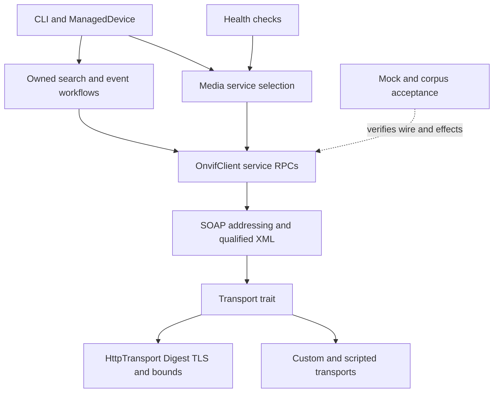

# ONVIF 互通性實作計畫

[English](onvif-interoperability-plan.md) | [繁體中文](onvif-interoperability-plan_zh.md)

I01–I10 已實作，[交付證據](#i07i10-交付證據)記錄本地檢查和待實機項目。
2026-11-11 的程式走訪基準為 `d77792564f9e9032f6d41bb6614ccbda80b92eba`、
workspace 0.17.1 及當時未提交的 HB1 候選。HB1 和實作已按功能提交，實機驗收延後。

第一批先改善錄影搜尋的完成判定與資源清理，建立不丟失 XML 身分的 endpoint
reference，再提供可管理生命週期的事件訂閱。認證選用及共用 Media1/Media2
唯讀流程接續這些基礎。後續新服務也有架構與開工條件，但不全部列為單一版本
的前置要求。

| 章節 | 用途 |
| --- | --- |
| [歸屬與基準](#歸屬與基準) | 保留已交付成果與單一工作歸屬 |
| [程式現況](#程式現況) | 實際 symbol、行為與既有測試限制 |
| [架構](#架構) | 模組邊界與擴充原則 |
| [交付順序](#交付順序) | 相依關係與有界批次 |
| [第一階段](#第一階段) | I01–I05 修改方向 |
| [後續服務能力](#後續服務能力) | I06–I10 擴充前的架構契約 |
| [相容性與驗收](#相容性與驗收) | API、schema、測試與實機證據 |
| [計畫檢查](#計畫檢查) | 此次文件變更的確認方式 |
| [I01 交付證據](#i01-交付證據) | 目前契約、相容性與本地驗收 |
| [I02–I06 交付證據](#i02i06-交付證據) | XML、認證、事件、媒體與 PTZ |
| [I07–I10 交付證據](#i07i10-交付證據) | 串流、疊加、擴充服務及互通性覆蓋 |

## 歸屬與基準

[post-0.17 backlog](post-0.17-backlog_zh.md) 仍是母計畫索引，本計畫負責 client
互通性 I01–I10。Mock W07–W23 仍由[執行清單](mock-fidelity-execution-checklist_zh.md)
管理；為 client 子批次新增測試，不代表整個 Mock 計畫結案。CLI 產品階段仍由
[CLI plan](oxvif-cli-plan.md) 與[hardening plan](oxvif-cli-release-hardening-plan.md) 負責。

保留下列已交付基礎：

- [下一版 P0–P6](next-version-plan_zh.md)：有界 HTTP/XML、Session report、安全
  trace、retry metadata、corpus 驗證及六個 Action 的 reference comparison。
  P5 實機證據仍是獨立驗收輸入。
- [HB1](mock-fidelity-http-binding_zh.md)：本地驗收通過的 header/status 政策、
  malformed/raw fallback 與拒絕保護。HB1 後續以 `b0be9ec` 提交。
- `ManagedDevice` 已快取 Session 60 秒，失敗及變更憑證時會失效，不再建立第二套
  CLI session cache。
- Media2 API、服務探索、PTZ node/options 型別、snapshot 認證、replay effects、
  有界的事件 Mock lifecycle 均已存在，後續改善其整合，不重列為缺少服務。

第一階段對應 F03 recording、F04 events、F05 interoperability、F15 使用端；
I05/I08 對應 F01 Media、I06 對應 F02 PTZ、I07/I09 對應 F08/F10 診斷與音訊產品
決策，I10 延伸 F14 驗證。這些是交叉歸屬，不新增平行實作佇列。原 P0–P6 的
候選版本並未替本次更廣範圍作版本決策。

## 程式現況

行號描述本次走訪，實作時仍應重新定位 symbol。以下是 source 觀察，不代表
量測過的多廠商失敗率或 ONVIF 認證缺失。

| ID | 實際程式與路徑 | 現況及影響 | 既有測試或證據 |
| --- | --- | --- | --- |
| S01 | [recording.rs](../../src/client/recording.rs) 的 `search_recordings` L400；[recording types](../../src/types/recording.rs) 的 `FindRecordingResults` | Poll 的 `await?` 位於 cleanup 前，失敗會跳過 EndSearch。滿二十輪即使未 Completed 仍回 `Ok(Vec)`，cleanup 錯誤被丟棄；`find_recordings` 的 Scope 固定為空。 | [recording tests](../../src/tests/client/recording_tests.rs) 有初始 Find 失敗及空的 Completed 結果；後者用同一份多 response envelope 並忽略 EndSearch 不符，無法證明 cleanup 順序或未完成處置。 |
| S02 | [events.rs](../../src/client/events.rs) 的 `event_stream` L295、`pull_messages` L116 | Stream 只持續對 URL Pull，遇錯終止；未擁有 lease、renew、reconnect、unsubscribe。PullMessages 只公開通知，未保留回應中的 lease 時間。 | [event tests](../../src/tests/client/events_tests.rs) 驗一筆事件及過期 Fault，未證明續租或取消清理。 |
| S03 | [event types](../../src/types/events.rs) 的 `PullPointSubscription`、`NotificationMessage`、`EventProperties`；[envelope](../../src/soap/envelope.rs) 的 `SoapEnvelope` | Pull subscription 只保存 URL/termination；通知保存 Topic、time、operation、Source/Data maps，未表示 Key、ElementItem、namespace identity、EPR ReferenceParameters。Envelope 支援 To/security，沒有 typed addressing headers。 | [notification compatibility](../../tests/notification_origin.rs) 鎖定舊 struct literal 與 JSON，直接加欄位會影響使用端。 |
| S04 | [XML DOM](../../src/soap/xml.rs) 的 `XmlNode`、`from_bytes_start`；[complete validator](../../src/soap/complete.rs) | Production syntax/resource 檢查已存在，但 compatibility DOM 移除 namespace 宣告並只保留 local names，不能往返 scoped EPR 或 QName-valued extension。 | 保留 [XML compatibility](../../tests/xml_compat.rs)、[response bounds](../../tests/soap_response_bounds.rs)；Mock 私有 Request tree 不應直接變成 production dependency。 |
| S05 | [client](../../src/client/mod.rs) 的 `with_credentials`、`security_token`、`call`；[transport](../../src/transport.rs) 的 `HttpTransport`、`Transport` | Default client 由同一 credentials 同時衍生 Digest 與 WSSE；custom transport 自主管理 Digest。Transport trait 只有回 String 的單一方法，HTTP timeout 目前配置於整個 client。 | [builder tests](../../src/tests/client/mod_tests.rs) 驗兩種順序與 default transport 失效；HTTP 測試已有 TLS、Digest、deadline。 |
| S06 | [Session](../../src/session.rs) 的 `build_with_report`、`fill_missing_service_urls`、`get_profiles` L620、`get_profiles_media2` L940 | 兩種 Media API 都有，GetServices fallback 與 URL 來源已有報告；一般 profile/URI 方法明確走 Media1，尚無共用選用流程。 | [Session tests](../../src/tests/session_tests.rs) 鎖定初始化 traffic、fallback precedence、缺服務錯誤與 report 分類。 |
| S07 | [CLI application](../../crates/oxvif-cli/src/application.rs) 的 `execute_diagnostic`、`build_http_transport`；[maintenance](../../crates/oxvif-cli/src/maintenance.rs) 的 `ManagedDevice`、`profile_report`、`connect`、`collect_inventory` | Profile 選取、diagnose、snapshot、inventory 使用 Media1 形狀；profile details 已正確以 encoder token 關聯。Session reuse、typed retry、native credentials、TLS roots 都已存在。 | Maintenance tests 涵蓋 cache expiry、cancellation、no-clobber、identity-aware inventory diff、private CA，需一起延伸這些路徑。 |
| S08 | [Media1](../../src/client/media.rs) 的 `get_stream_uri`；[Media2](../../src/client/media2.rs) 的 `get_profiles_media2`、`get_stream_uri_media2` | Live URI setup 固定，Media2 profiles 固定請求 All；已有 audio output/decoder reads、metadata setter，但沒有 Media2 OSD/privacy masks、output/decoder setter/options。 | Media1/2 client tests、[rate control](../../tests/media2_rate_control.rs)、audio/metadata、OSD suites 已涵蓋選定範圍。 |
| S09 | [PTZ](../../src/client/ptz.rs) 的三種 move、Stop；[PTZ types](../../src/types/ptz_config.rs) 的 `PtzSpaceRange`、`PtzSpeed` | Move 固定同時送 PanTilt/Zoom，未公開 per-move space/speed/timeout、per-axis Stop。Range parser 對缺少或錯誤的 limit 使用 legacy default，不能把它當作裝置已宣告範圍。 | PTZ tests 與 [profile identity](../../tests/mock_ptz_profile_identity.rs) 有路由證據，並非所有 axis/space 或實體移動驗收。 |
| S10 | [Health](../../src/health/checks.rs) 的 `services`、`media`、`rtsp_options_probe`；[snapshot](../../src/health/snapshot.rs) | Health 已可在 force 下探測 Media2 candidate URL；一般 media check 仍走 Media1/第一個 profile。RTSP OPTIONS 200/401 僅代表可達，authority parser 支援 IPv4/hostname；snapshot 已共用 URL/auth/size 政策。 | 保留 force-only 診斷及既有 snapshot tests，不把猜測 URL 自動變成正式服務路由。 |
| S11 | [Mock recording](../../src/mock/services/recording.rs) 的 `resp_find_recordings`、`resp_recording_search_results`；[policy](../../src/mock/policy.rs) 的 `SearchEnd` | Mock search 是固定 token、整批 Completed，EndSearch 仍為 acknowledgment-only，不能作 paging/lease cleanup 的唯一 oracle。 | 既有 Mock 測試繼續保留；I01 首批使用 scripted transport 與本地 HTTP fixture。 |
| S12 | [Mock lifecycle](../../src/mock/services/events/lifecycle.rs)；[projection](../../src/metamorph/projection.rs) 的 `projection`；[regression](../../src/metamorph/regression.rs) | EP2 已有獨立 event endpoint/queue/lease；reference comparison 已處理 DeviceInformation/Hostname 及兩種 Media 的 profile/encoder lists。 | [event lifecycle](../../tests/mock_event_lifecycle.rs)、[corpus](../../tests/corpus_regression.rs)、[reference comparison](../../tests/reference_comparison.rs) 是可重用基礎；動態事件時間與更多 projection 仍需獨立契約。 |

協議核對依據為[官方規範索引](https://www.onvif.org/profiles/specifications/)、
[Media2 26.06](https://www.onvif.org/specs/srv/media/ONVIF-Media2-Service-Spec.pdf)、
[Recording Search 26.06](https://www.onvif.org/specs/srv/rsrch/ONVIF-RecordingSearch-Service-Spec.pdf)、
[PTZ 26.06](https://www.onvif.org/specs/srv/ptz/ONVIF-PTZ-Service-Spec.pdf)、
[WS-Addressing Core](https://www.w3.org/TR/ws-addr-core/)。審閱結論是：服務能力依
capability 判定、EPR parameters 帶 scoped XML 身分、Media2 設定與實際串流 transport
是不同契約。官方 XML 資源保留在 checkout 外，本計畫只保存審閱後的設計結論，
不複製 schema 或產生規範清冊。

## 架構

`src/client/` 保留 stateless service RPC，`src/soap/`、`src/types/` 負責協議表示，
有生命週期的流程放入各自領域模組。CLI 與 Health 使用同一 library workflow，
不成為其核心擁有者。第一個切片需要時才建立模組，不預先重排無關 service 或拆 crate。

| 提議的邊界 | 責任 | 不放入此層 |
| --- | --- | --- |
| `src/soap/addressing.rs`、`src/soap/qualified.rs` | 有界 namespace-aware fragment、EPR、request addressing、serialization | Lease timer、vendor URL 改寫、憑證持久化 |
| `src/client/auth.rs` | 明確 SOAP-auth policy、default transport credential 衍生 | OS keyring 存取、自動降低認證強度 |
| `src/recording/search.rs` | Search ownership、polling budgets、completion/cleanup report | Recording CRUD、影片 decode、通用 job framework |
| `src/events/model.rs`、`src/events/subscription.rs` | 完整事件資料與單一 owned managed subscription | 無界 broker/history、UI state、全域 worker registry |
| `src/media/catalog.rs`、`src/media/route.rs` | 帶 service 身分的 profile handle、configuration 關聯、operation 選用 | Decoder lifecycle、第二套 CLI session cache |
| Optional `src/streaming/` | RTSP protocol adapter、有界 probe/backchannel session | 預設 SOAP dependency graph、GUI rendering |

以下新型別/API 名稱都是設計草案。新的可擴充公開型別優先用 constructor/accessor，
既有 public literal、error match、serde 形狀、custom Transport 都是相容性輸入。
不為這些切片建立通用 XML operation engine、背景 job framework 或 vendor-name switchboard。

## 交付順序

| 批次 | 範圍與相依 | 完成條件 |
| --- | --- | --- |
| A | I01 search 正確性與明確 outcome | Poll 失敗會清理；未完成結果不能偽裝成完整成功 |
| B | I02 qualified XML/EPR、I03 認證及 request budgets | Captured wire、自訂 transport、舊使用端相容控制通過 |
| C | I04 managed events，依賴 B | 續租、backpressure、recovery、shutdown 通過可重現併發控制 |
| D | I05 shared media reads，依賴 B 的分類能力 | Media1-only/Media2-only、多 source 流程可經 Library、CLI、Health 使用 |
| E | 選擇 I06 PTZ、I07 streaming probe 或 I08 Media2 OSD/masks | 一個完整 capability-driven 子批次具 wire/effect 證據 |
| F | I09 audio/analytics/recording extensions、I10 更廣 reference acceptance | 每個功能通過自己的架構與驗收邊界，不整批宣稱 Profile 支援 |

I10 驗證隨前面各批次執行。F11 discovery、裝置 certificate/backup 管理與 distribution
仍是分開的後續範圍；此順序不承諾發布日期，也不代表已授權執行實作。

## 第一階段

### I01 錄影搜尋結果與資源歸屬

先處理 S01/S11，保留直接 Find/Poll/End RPC。新增 `RecordingSearch` owner 與
options/report API，包含總 deadline、最大 pages/items/保留 bytes、wait interval、
明確 completion/stop reason。Decoded page 在保留前先檢查容量；單一 XML response
上限不能取代明確的累積結果 budget。保留裝置頁面順序，沒有定義 page 契約前不自行以 opaque
token 去重。

取得 token 後，所有正常返回路徑都執行一次有 deadline 的 cleanup attempt，包括
poll/parse 失敗與 budget 耗盡。Primary failure 優先，cleanup 成敗獨立呈現，能取得
時保留 EndSearch endpoint value。Polling budget 到期後，cleanup 使用自己較小的
budget。初始 Find 失敗時沒有 token 可關閉；Find response 尚未收到就取消，可能
留下未知的遠端 token，此時依 remote lease 回收，不能保證 cleanup。

提供明確 async `close`/`cancel_and_close`；Drop 只做 local cancellation，不暗中
spawn runtime task。外部直接 abort future 時不能保證遠端 EndSearch，應明載此
邊界與 lease expiry。使用 paused clock、逐 operation captured call log 驗證順序，
不把完整 W14 Mock search fidelity 當作首批必要前置。

相容策略：新 report API 使用獨立 workflow error，攜帶 partial results 及 cleanup
disposition。舊 Vec helper 保留 signature，但未完成搜尋不能繼續回成功；加入
具名 incomplete error 所需的公開 error/semver 遷移必須明確審查，不偽裝成 HTTP
status 或 MissingField。一般 poll 失敗仍保留原始 error，cleanup 詳情透過新 report
提供。

驗收：Find 失敗不 cleanup；poll 失敗對精確 token cleanup；Queued/empty/multi-page；
邊界 Completed；deadline/page/item/byte 耗盡；unknown state；cleanup Fault/timeout；
取得 token 前後的 cancellation；兩組獨立 search。以逐 Action scripted reply 及
HTTP 控制取代多 response fixture；擾動 completion 判讀與 cleanup dispatch 證明 guard。

### I02 Scoped XML 與 endpoint reference

新增小型 qualified representation，保留 expanded element/attribute names、
mixed-content 順序及 QName value 必要的 namespace bindings。共用 complete-input
validation，明列 bytes/depth/nodes 與 extension fragment 保留上限。既有 XmlNode
API/語意維持不變；不依賴 `mock::Request`，也不順手把整個 Mock parser 搬到
production。共用 primitive 前，先比較現有 qualified projection 實作。

EPR 模型由 address 與有序、已驗證的 reference parameters 組成。重新序列化必須
保留 QName-valued content 的作用域與 shadowing，只有 expanded-name map 不足。
ElementItem extension 共用同一有界表示，不用 raw String 拼接裝置回傳的 header。
Opaque fragment serialization 屬 wire 能力，日常 log/CLI output 應省略或清理。
轉送 credentials 前，EPR/service destination 要通過明確 scheme/origin policy；
跨 origin 裝置需配置 trust rule，不靜默改寫地址，也不把認證過的 response 視為
對所有 advertised destination 的信任。既有 caller-directed RPC 保留原契約，
這是新 managed API 的明確行為邊界。

新增 private call builder，承載 Action、destination、typed addressing headers，
service methods 保留精確 Action 常數。Pull/Renew/Unsubscribe 使用 EPR parameters。
改動既有 wire 前，逐 operation 核對 Core/WS-Notification binding 的 addressing
要求；SOAP Content-Type action 本身不提供 EPR 模型。

新增完整 subscription/event 型別並提供到舊型別的明確轉換，保留
`notification_origin.rs` 的 literal/JSON 契約。Legacy projection 可明載資料損失，
managed API 必須保留 Key、有序重複 item、ElementItem、topic/dialect 的 namespace
identity，不把完整資料靜默壓成 HashMap。

驗收：alternate/default namespaces、sibling/ancestor rebinding、相同 address
但 parameters 不同的兩個 EPR、parameter 順序/escaping、qualified attributes/
QName values、nested decoys、duplicate/invalid shape、retention limits、後續
請求的 captured headers、舊 literal/serde 使用端。

### I03 認證選用與 request budgets

Credential handle、明確 SOAP-auth policy、transport auth configuration 分開。
新模式涵蓋 Digest-only、WSSE-only、legacy combined；舊 `with_credentials` 維持
combined。Custom transport 在兩種 builder 順序下仍自主管理 HTTP authentication；
default client 僅在衍生輸入改變時失效。CLI 繼續使用既有 native store、PEM-root builder。

[Profile S transition](https://www.onvif.org/profiles/profile-s/profile-s-deprecation-qna/)
於 2027-03-31 後不再接受新的 Profile S conformance 提交，既有安裝繼續可用。
因此提供明確選用能力，保留 legacy 支援，不依 Profile 標籤猜認證機制或自動降級。
Clock Auto 應依選定 WSSE 行為判斷，Always/Never 仍為明確選項；只報告選用機制，
不輸出 credentials、challenge 或 raw EPR headers。

Managed long-poll 也需要經審查的 request-budget 擴充。方向是新增有預設實作的
Transport method，接受 per-request options；HttpTransport override 在 plain 與
Digest 路徑都設定 request timeout，舊 required `soap_post` 不變。預設擴充實作應
執行 outer deadline，並明載未知 custom transport 可能有更短的 inner timeout，
不能聲稱可延長其上限。Override 保留 body cap、TLS trust、Digest credentials；
不以重複觸發既有十秒 timeout 偽裝支援 long-poll。

驗收：三種模式的 captured wire、兩種 builder 順序、自訂 transport 不被替換、
TLS/private roots、challenge 失敗不降級、mode-aware clock、同時執行短請求與
long poll、含 Digest retry 的整體 deadline、取消與 oversized Fault body。

### I04 Managed event subscriptions

基於 I02 EPR/rich events 與 I03 budgets 建立新 API，保留低階方法與舊 borrowing
stream。一個 managed owner 管理一個 lease、worker、bounded data queue，狀態機為
Creating → Active → Renewing/Recovering → Closing → Closed/Failed。此為 client
抽象，與 Mock EP2 的 device-side state 分開。

保留 create/renew/pull 的 CurrentTime/TerminationTime，將有效 lease interval
轉為 monotonic deadline，不用有偏差的 wall clock 猜測。首版 managed API 要求
有效 granted timing，否則回 typed timing failure，並對已知 subscription 嘗試有界
cleanup；仍可使用直接 legacy calls。使用 Tokio monotonic clock，讓 paused-time
測試涵蓋真正排程。在到期前以有界 margin 續租。Renew/control 不能被 blocked long-poll 或慢 consumer
卡住，不把所有事情串在單一 await，也不持鎖跨 network I/O。立即空回應使用
minimum cadence，避免 busy polling；限制 retry 次數、recovery elapsed、queue
bytes/message 數量。

Queue overflow 政策必須明確：consumer 阻塞不能餓死續租，資料損失須回 gap/overflow
item 或 terminal error，不能靜默丟棄。Transient recovery/resubscribe 產生 gap marker，
不聲稱 exactly-once，也不在裝置沒有對應能力時保證補回遺失事件。Recovery 僅依
typed、已審閱的 retry/expired-lease disposition，不比對 vendor reason text；
credential/TLS/policy 失敗終止 recovery。

`close().await` 取消 in-flight pull，在 cleanup budget 內嘗試 Unsubscribe，並 join
owned worker。Drop 取消/abort 本地資源，遠端仍以 lease expiry 兜底。不留下 detached
retry/unsubscribe task，clone 語意也不能意外產生多個 polling/renewal owner。
Push listener 維持獨立 inbound transport，保留已交付上限。

驗收：paused-time renewal/expiry/skew、blocked pull/full queue 時仍能 renew、立即
空回應、auth 失敗、有界 reconnect/resubscribe、可觀察 duplicate/gap policy、
consumer drop/explicit close、close 後無請求、instance isolation。EP2 驗既有
lifecycle，額外 scripted delay/concurrency fixture 補立即 synthetic Mock 無法模擬的行為。

### I05 共用 Media1 與 Media2 唯讀流程

新增帶 service 身分的 profile handle 與 read catalogue，包含 profile/source/
configuration/encoder 身分與 endpoint provenance。保留兩種 Media 原生型別，
共同 summary 不把 Media2 強制轉成 Media1，也不充當 lossless editor。依回報 token
關聯，不用陣列位置或 profile 名稱；同一攝影機的兩種 service 可能使用不同身分。

新 workflow 明確提供 Media1/Media2/Auto。Auto 使用 advertised/captured service
資料與 typed unsupported disposition，附 attempt report；auth、timeout、XML、
policy 失敗不觸發盲目 fallback。舊 explicit methods 與既有 CLI default 保留，新
output shape/service selector 必須有具名契約與遷移測試。重用 ManagedDevice cache/
invalidation，猜 endpoint 限於 Health 的明確 force。Reconnect 或 configuration
invalidation 時更新 catalogue，不新增全域快取。

依已實作 protocol 與 capability 新增 typed stream-request options，分開「取得 URI」
與「接收 RTP」的責任；URI 不證明 playback。Profile/source filters、compatible
configuration queries 逐批新增，保留 opaque token 與 optional absent 欄位。

一起更新 CLI `profile_report`、picker、diagnose、stream/snapshot、inventory 與
Health media checks。保留 no-clobber、destination policy、read-only default、
retry units、Session URL/report precedence；設定匯出仍是 inventory，不變成可還原備份。

驗收：Media1-only/Media2-only/both、缺少或故障的 advertised URL、真正 unsupported
Fault 與 auth/transport 失敗、兩鏡頭不同 encoder、同名不同 token、profile ambiguity、
typed URI setup、既有 Session traffic、CLI human/JSON/JSONL/schema/exit contracts。

## 後續服務能力

### I06 PTZ 移動選項

重用 PtzNode/Configuration/Options，新增 per-operation request types，讓 PanTilt/
Zoom 可省略、space URI 明確，並支援 optional speed、ContinuousMove timeout。
已知 capability 下，在 I/O 前拒絕 NaN/infinity 及不支援的 axis；未提供的 axis
不能序列化成零值。使用 bounds 驗證前，先區分裝置已回報值與 parser legacy default；
未知範圍維持未知，最終限制以裝置為準。保留 convenience wrappers 與既有 wire，
以 additive API 提供新選項。Explicit Stop/operation timeout 定義遠端行為，Drop
不能保證實體停機。這是 library 子批次，不授權 CLI 裝置寫入。

驗收：zoom-only、pan/tilt-only、兩個 head/default spaces、finite boundaries、
optional speed/timeout、per-axis Stop、client wire capture。Mock 只證明 modeled
state/refusal，實體時間仍需具名設備證據。

### I07 分層串流診斷

既有 OPTIONS reachability 放到小型 RTSP protocol adapter 後方。選用成熟實作前
檢查 license、MSRV、TLS/auth、cancellation、resource limits，維持 optional，讓
SOAP-only 使用端不增加 decoder/media dependencies。使用成熟 URI parser，IPv6/
RTSPS 沿用同一 destination/trust policy。

分別報告 address/TLS connection、OPTIONS、authenticated DESCRIBE/SDP/codec、
optional SETUP/PLAY/first-packet。401 表示可達但需認證，不是播放成功。限制 bytes、
headers、redirects、connections、teardown time；不向未審閱的 URI authority 送
credentials，也不記錄 URI secrets。Decoder/UI、長時間 playback 是後續使用端，
不自動成為 Health 的責任。

驗收：本地 RTSP server 提供 200/401/malformed/分段回應、unsupported codec、
IPv6/RTSPS、auth 失敗、無 packets、cancellation/teardown、redacted reports。
Snapshot 的 auth/URL/image 政策獨立保留；格式修改仍需要 F10 的外部 capture。

### I08 Media2 OSD 與隱私遮罩

語意相同的 OSD domain value 可共用，wire codec 按 service 分開；現有 OSD serializer
硬編碼 Media1 `trt:OSD` wrapper，不能用字串取代重用。Privacy mask 另有 domain，
包含 source/config 身分、geometry/coordinate-space options、tokens、支援欄位，
不當作黑色 OSD 矩形。

OSD 與 mask family 分為有界批次：capability/options → read → explicit mutation →
read-back。已知時先驗 quota/geometry，再 commit；拒絕未建模 write fields，保留
無關 source/mask state。Mock effect、replay invalidation 僅在 commit 成功後發生。
Image-upload、不支援的 vendor extension、CLI write UX 都是獨立範圍。
裝置 mutation 不自動 retry；回覆遺失可能代表遠端 outcome unknown，必須有獨立
disposition，能力允許時才有界 read-back。多次呼叫不等同 client atomic transaction，
local rollback 也不能覆寫並行裝置變更。Mock rejection atomicity 與 transport 失敗後
的實體裝置 rollback 是不同宣稱。

驗收：獨立 scoped request/response 判讀、alternate namespaces、兩個 source、
create/update/delete、quota failures、拒絕不改 state/hooks/replay，以及明載共享
source 的部分影響。新增 wire instance 在 conformance 宣稱前須完成外部 schema 驗收。

### I09 音訊 analytics 與錄影擴充

以下各為獨立產品切片，分別進入實作：

| 切片 | 架構與首批範圍 | 擴充前的驗收 |
| --- | --- | --- |
| Audio configuration | 以 service-specific codecs 補 source/output/decoder Get/Set/Options，僅在 wire 語意相同時共用 audio types；區分 source/output/config/profile tokens。 | 支援 codec/range/binding，不能假設 input/output 對稱；拒絕保留 state/effects。 |
| Talkback | Optional backchannel owner 使用 I07 RTSP adapter，負責 codec negotiation、有界 encoder/input queue、clock/packet pacing、teardown；SOAP controls 不等同 audio transport。 | SDP/backchannel negotiation、選定 codec fixture、partial send/disconnect、半/全雙工 policy、shutdown；實際聲音需設備驗收。 |
| Analytics 與 Profile M | 先做 Analytics/RuleEngine capability、module/rule reads、I02 rich metadata。保留 QName parameter 身分、順序、有界 ElementItem，write API 前先建立 typed parameter descriptors。EventBroker 設定與執行 MQTT client/broker 分開。 | Unsupported module/schema、namespace collision、vendor extension 明確保留/拒絕、可發布 metadata fixture；不只用自己的 parser 宣稱 conformance。 |
| Recording timeline/export | Summary/info/media-attribute、event-search API 建於 I01 search owner，使用 typed scope/time filters；export 是獨立 async job owner，提供 progress/cancel、驗證過且有界的 download destination。 | Paging/expiry/cleanup、timezone boundary、export job failure、no-clobber/cancellation；不把 configuration inventory 當錄影匯出。 |

[Profile M](https://www.onvif.org/profiles/profile-m/) 包含 metadata/analytics，以及
依 capability 適用的 event/MQTT interface。新增一個 service family 不代表整個
Profile M/G；WebRTC、media signing、draft profile 採用需要獨立產品及依賴決策。

### I10 Mock 與 Metamorph 驗收整合

重用 corpus manifests、request pairing、mask、明確 Unsupported/Unexamined。
每個交付功能增加一個經審閱的 projection family；URI 欄位要有 volatile/secret
政策，動態 events 要有 ordering/time-window 契約，不作靜態讀取的 byte equality。
保留 collision buckets、raw evidence；stateful session 不能只 replay 一筆固定成功
response 就算驗收。

Client 子批次先用小型 scripted transport。Production Mock 擴充仍由既有 service
owner 處理：真正 per-search state 屬 W14 子批次，EP2 lifecycle、HB1 precedence
保留，roles/push/full fault-injection redesign 分開。驗 failure atomicity、hooks、
queues、independent instances、committed replay invalidation。相容矩陣依
version/vendor/model/firmware/auth/service 與測過 workflow 記錄；synthetic、external
schema、real-device 結果分欄保存。

## 相容性與驗收

每批開工前固定 request/result/error contract 與 C01–C12 案例；檢查 literal/custom
Transport 及 serde/CLI 兩類 downstream consumer。新 error variants、exhaustive
enum、return type、Media1/2 JSON 形狀要有明確遷移與版本決策。同步 CLI schema v3、
descriptor examples、error/exit contracts；`meta.additionalProperties = false`，
不能將任意新 metadata 塞進該欄位。

每個新 owner 都要列 resource table：request/response/extension/retained bytes、
messages/items、tasks/connections、retry count/elapsed budget、cleanup deadline。
預設公開、有界，營運需要時可調整。共用 cancellation/typed retry primitive，但
不把 CLI policy 匯入 library，避免 workflow/RPC 兩層各自 retry。
需要時只將可重用的純 failure classification 移入 library；CLI 保留 command
attempt units 與產品 retry policy，不將整個 executor 複製到每個新 workflow。

| 證據 | 必要邊界 |
| --- | --- |
| Unit/wire | 精確 Action、endpoint、scoped XML、typed outcome、欄位值；malformed/duplicate/limit；獨立 literal fixtures |
| Workflow | 可控制時鐘、captured operation order、cleanup error precedence、backpressure/concurrency、cancellation、instance isolation |
| Sensitivity | 每個 coherent slice 一次 planned mutation batch；未篩選 all-feature/no-fail-fast、預期 assertion failure、精確還原 |
| Workspace | Format；all-target Clippy、all-feature/default tests，locked；兩種 strict rustdoc；依變更邊界執行相關 feature/MSRV checks |
| New XML | Checkout 外 pinned resources 的獨立 schema/corpus 驗證；ignored 不算驗收 |
| Device | 按切片具名記錄 Media1-only/Media2-only、Digest-only/combined、clock skew、subscription expiry、多鏡頭/zoom-only，附 sanitized capture/provenance |
| Delivery | OPERATIONS、library/public docs 只宣稱已實作範圍；雙語文件、CLI schema/examples、F/W owner 同批更新 |

未來 device certificate/backup 管理應區分唯讀 inventory 與明確裝置 mutation，
設計 certificate/key custody、rotation rollback、有界 artifact transfer。Discovery
擴充保留 interface/family 身分，用 owned listener/cache 管理 TTL/Hello/Bye/Resolve，
不再加全域 registry；multicast/IPv6、LAN/VMS 證據仍屬 F11。這些架構開工條件
不把兩者排入首批；credential migration、distribution 保留各自驗收 owner。

## 計畫檢查

本次重新檢視 S01–S12 的現行 implementation/tests，以下計畫檢查均通過：

- 十六個檔案的 38 個 source symbol anchors、雙語 S01–S12 findings、I01–I10
  工作包一致；另檢視連結的 types、test helpers、Mock lifecycle、CLI schema、
  snapshot、discovery 與既有計畫歸屬。
- 新計畫、文件索引、雙語 backlog 共 315 個本地連結目的地有效；新計畫十六個
  navigation anchors 皆存在。
- `git diff --check` 通過；原本 24 個 dirty files 的內容均保留，只有兩個 backlog
  追加連結。HEAD 不變、index 空白，本地檢查 script/snapshot 位於 ignored `target/`。

原始計畫批次只新增設計文件/索引，未重跑 runtime tests；以上證據描述當時的
文件檢查點。後續 I01 實作與驗收另記於下方。

## I01 交付證據

2026-11-11：本地實作與驗收完成，後續以 `4b12354` 提交。S01/S11 描述 I01
之前的走訪；本批修正 S01 的完成判定與清理缺陷。Typed search scope/filter
擴充及 W14 Mock search lifecycle fidelity 仍屬後續工作。

- [Owned search](../../src/recording/search.rs)：具驗證的 options、單次 owner、
  可複製取消 handle、report/failure 型別與獨立 cleanup outcome。預設 Find/poll
  120 秒、20 頁、2,000 筆、16 MiB accounted retained results、每次 100 筆/PT5S、
  100 ms cadence、PT60S keepalive、另計兩秒 cleanup。一次一個 RPC、不建立 task、
  不重試流程。計算方式及沿用的 XML/transport 邊界見
  [資源表](../../LIBRARY_GUIDE_zh.md#search-與-replay-service-方法)。
- [Client](../../src/client/recording.rs) 與 [Session](../../src/session.rs)
  提供 owner/report API。即使最後允許的一頁，也必須 Completed 才成功。
  被拒絕頁面不部分保留；先前結果及原始錯誤仍可取得。正常離開時若已有 token，
  會嘗試一次有界 EndSearch；cleanup 不取代主錯誤。有 Endpoint 時原樣保留，
  缺少 Endpoint 時沿用低階 RPC 的相容行為。
- 明確 async close 具冪等性。Pending close 被丟棄時記錄 Interrupted，不重試
  遠端結果未知的操作。外部丟棄 run 後，需保留 owner 並明確 close。Owner Drop
  只發出本地取消；Find 回覆遺失只能依賴遠端 lease，無法保證清理。
- 相容性決策：維持 Vec helper 簽章及原始 RPC 錯誤，但未完成結果改回
  `OnvifError::RecordingSearchIncomplete { reason }`。新增 exhaustive variant
  要求下游 match 更新及下一個 minor release 檢視，不可視為相容的 0.17.x patch。
  本批不修改版本或發布。Session 使用 ResponseData；Health 使用 Precondition
  且不偽造 fault 欄位；CLI maintenance 使用 SEARCH_INCOMPLETE 且不重試。
  CLI schema v3 不變。
- [獨立生命週期控制](../../tests/recording_search_lifecycle.rs) 的 21 個 all-feature
  案例已通過，涵蓋限制、部分結果、主錯誤/cleanup 錯誤、paused clock、取消、
  外部丟棄 future、雙 owner、Session 路由及實際 HTTP 400/500 SOAP Fault。
  舊空結果 unit fixture 改為逐 Action 回覆，斷言 Find/Poll/End 順序及 exact token。
  CLI maintenance guard 驗證具名分類與單次嘗試政策。

最終本地 gates 均通過：

| Gate | 證據 |
| --- | --- |
| Format | `cargo fmt --all -- --check` |
| Workspace Clippy | `--workspace --all-targets --locked -- -D warnings`，all-feature 與預設模式皆通過 |
| 完整測試 | `cargo test --workspace --all-features --locked --no-fail-fast`：1,451 passed；預設模式：1,317 passed；兩組均為 53 suites、七個既有 ignored |
| 嚴格 rustdoc | `RUSTDOCFLAGS="-D warnings" cargo doc --workspace --no-deps --locked`，all-feature 與預設模式皆通過 |
| 獨立 core | 僅選 oxvif package 的 `--no-default-features` all-target Clippy、20 個生命週期案例及嚴格 rustdoc，避開 CLI feature unification |
| 文件／worktree | 437 個本地連結目的地、20 個 plan anchors、`git diff --check`；21 個受保護基準檔逐位元組相同；共用 lib/changelog 原有新增內容保留；HEAD 不變、index 空白 |

一次預先規劃的 combined sensitivity batch 停用 cleanup dispatch，並反轉完成
判定。未篩選的 all-feature workspace/no-fail-fast 執行到全部 53 suites，出現
19 個預期失敗測試，包含
`queued_then_completed_preserves_records_order_fields_and_wire_options` 及
`malformed_poll_still_releases_the_exact_token`。失敗來自執行期 guard，而非編譯
錯誤。程式在綠燈 gates 前逐位元組還原；本地 script/log 位於 ignored
`target/i01-*`。

沒有實機 capture 或外部 schema 驗收，不宣稱通過。I02–I10 維持 TODO，既有
F/W 狀態不變。當時 HB1 與 I01 維持未提交。接續的 I02 scoped XML/EPR 契約以
獨立 namespace/reference-parameter 控制驗證，再加入 managed subscriptions。

## I02–I06 交付證據

2026-11-11 批次實作五個工作包，依適用範圍接上 Library、Session、CLI
及 Health 入口。前段的 source walkthrough 保留原始基準。

| 工作包 | 實作與證據 |
| --- | --- |
| I02 | [Qualified XML](../../src/soap/qualified.rs) 保留 expanded names、namespace shadowing 與內容順序。[Referenced pull point](../../src/events.rs) 保留有序參數及完整通知項目。用獨立腳本檢查送出的 headers、重複欄位、上限及端點信任。 |
| I03 | [Client 認證](../../src/client/mod.rs) 支援 Combined、Digest、WsSecurity。[Transport options](../../src/transport.rs) 限制整次直接交換並使用已設定的 TLS roots 和 response cap。用本地 HTTP 檢查認證、Digest challenge 與重送的共用 deadline，以及拒絕 Basic 降級和 redirect。 |
| I04 | [受管理事件](../../src/events/managed.rs) 由單一 owner 管理 lease 和 worker。Pull 等待期間仍可續租，佇列超限及恢復的 Gap 明確回報。Paused-clock 測試涵蓋續租、恢復、超限、close 與 drop。Mock EP2 的 bound-port 測試涵蓋建立、收取及取消訂閱。 |
| I05 | [媒體流程](../../src/media_workflow.rs) 保留原生型別、profile 與服務身分。Auto 優先已宣告的 Media2，在端點缺少或 qualified unsupported Fault 時回退。CLI 的 profiles、picker、diagnose、URI、snapshot 及 inventory 使用 Session 上下文。Health 媒體檢查共用服務選擇，coverage 以完整 Action 區分。 |
| I06 | [型別化 PTZ](../../src/ptz_motion.rs) 支援可省略軸組、空間、速度、連續 timeout 與分軸 Stop。依操作類型的已知範圍驗證。Mock 讀回確認選定 head 的 zoom 改變，pan/tilt 及另一 head 保持原值。 |

省略 CLI 的 media selector 時使用原有 Media1 profile array。選擇服務後，
profile 結果包含服務、端點來源、嘗試紀錄與原生 profile 列表。CLI envelope
使用 schema v3。Rust TransportError 的 exhaustive match 需處理 Deadline。
CLI 函式庫 ExecutionOptions 可用 Default 初始化新增的認證與媒體選項。

已查核 [ONVIF 規格](https://www.onvif.org/profiles/specifications/)、
[WS-Addressing SOAP binding](https://www.w3.org/TR/ws-addr-soap/) 與
[WS-BaseNotification](https://docs.oasis-open.org/wsn/wsn-ws_base_notification-1.3-spec-os.htm)
的 addressed operations 及租期行為。外部 XSD 位於 checkout 之外。
由於官方 ONVIF extension type 有歧義，.NET 驗證器關閉 Unique Particle
Attribution 檢查，驗證擷取請求的 SOAP Body 操作元素。Reference headers
以獨立 qualified wire assertions 驗證。

| 本地檢查 | 結果 |
| --- | --- |
| 格式、all-target Clippy、嚴格 rustdoc | Workspace 全功能與預設模式均通過 |
| Locked workspace 測試 | 全功能 1,471、預設 1,337 個測試通過。兩組皆執行 54 個套件，7 個既有 ignored。 |
| 純函式庫 | 無 optional feature 的 all-target Clippy、嚴格 rustdoc 與 17 個生命週期、認證、媒體、PTZ 測試通過。 |
| 重點整合 | 19 個互通性測試通過，包含 Mock EP2 和雙 head PTZ 讀回。CLI process 測試驗證 table、JSON、JSONL、diagnose 與 inventory，並檢查 schema v3。 |
| 外部 schema | 使用 15 份資源驗證 92 份 SOAP Body 請求、涵蓋 20 項操作。ONVIF schema 固定於 `7dd791435c69944f6f18b9dd1e50ff189a442338`。 |
| 敏感度 | 一批暫改 reference marker、認證選擇、恢復 Gap、錯誤回退與省略軸組。跑到全部 54 個套件，6 個測試如預期失敗。五個檔案逐位元組還原後通過正式檢查。 |

本地紀錄位於 ignored `target/i02-i06-*`。外部資源雜湊與 schema 一併存放於
checkout 之外。實機驗收留待後續。HB1、錄影搜尋、共用 Client 流程及 PTZ 已分別提交。

## I07–I10 交付證據

| 工作包 | 實作與範圍 |
| --- | --- |
| I07 | [RTSP 配接層](../../src/stream_probe.rs) 分別回報連線、OPTIONS、認證後的 DESCRIBE／SDP，以及選用的 SETUP、PLAY、首個視訊 RTP 封包和 TEARDOWN。CLI 用 `--rtsp-probe describe\|packet` 開啟。Health liveness 執行 description probe，snapshot 沿用獨立的策略。串流必須與裝置同 host，可不同 port。HTTPS 裝置要求 RTSPS，透過系統／額外 CA 驗證伺服器名稱。Basic 只在 TLS 上使用。MIT 授權的 `rtsp-types` 和 `sdp-types` 屬於選用的 `stream-probe` feature。 |
| I08 | [Media2 疊加](../../src/overlays.rs) 綁定來源 configuration，分開處理 OSD 和隱私遮罩。文字 OSD 與多邊形遮罩支援選項、讀取、明確寫入與讀回。裝置擴充欄位與影像上傳有各自的範圍。回覆遺失時回傳 `OutcomeUnknown`，可讀回確認遠端狀態。Mock 的兩種 Media binding 共用 OSD，遮罩則各 instance 獨立。 |
| I09 | [音訊設定](../../src/audio_configuration.rs) 依 Media1／Media2 的實際 binding 實作。[對講](../../src/stream_probe/talkback.rs) 選擇一條 PCMU send track，將 PCM 依時序送出。[Analytics](../../src/analytics.rs) 讀取規則、模組、支援描述與 metadata XML，保留 QName 和擴充欄位。[錄影時間軸](../../src/recording/timeline.rs) 讓事件搜尋共用 I01 owner。[匯出](../../src/recording/export.rs) 管理遠端 job，[下載](../../src/recording/download.rs) 接受明確指定的 URL 和本地目的地，以不覆寫方式發佈。 |
| I10 | [W14 Search](../../src/mock/services/recording/search.rs) 依 token 管理獨立快照、分頁和期限。[Metamorph 投影](../../src/metamorph/projection.rs) 將支援的完整 Action 擴到 16 項，沿用 corpus 配對及 unexamined 欄位。[事件視窗](../../src/metamorph/event_window.rs) 按擷取順序比較具限定名稱的 topic、操作和相對時間。內建 replay 將 Search 與 EP2 生命週期交給 live handler，overlay 確定提交後才使對應 replay 讀取失效。 |

| Owner | 資源上限與清理 |
| --- | --- |
| RTSP 診斷 | 一條連線、零 redirect，header 16 KiB／64 欄、SDP 64 KiB、每次回覆或首包等待至多 64 個 interleaved frames。預設總計 5 秒，其中首包最多 2 秒，另計 1 秒 TEARDOWN。每個命令最多重送一次認證。 |
| 對講 | 單一 PCMU track，佇列 16 幀、每幀 20 ms，預設 1,500 封包或 30 秒，另計 1 秒 TEARDOWN。首版為半雙工送出，接收端解碼有獨立的範圍。 |
| 疊加、音訊與 Analytics | Scoped SOAP 每次 10 秒，沿用 production XML 4 MiB／深度／元素上限。疊加與音訊最多 1,024 筆，遮罩最多 64 點。音訊每筆未建模資料最多保留 256 KiB，Analytics catalogue 與 metadata 各有 256 KiB 上限。一次寫入後獨立讀回。 |
| 時間軸與匯出 | 明細讀取保留最多 256 KiB，事件搜尋沿用 I01 限制及 EndSearch 清理。匯出進度最多 512 個檔案與 256 KiB，預設最多 120 秒／120 次、每秒一次，Stop 另計 2 秒。 |
| 匯出下載 | 一次直接 HTTP(S) 請求，預設 120 秒及 256 MiB。取消或失敗時清理暫存檔。即使其他程序在下載途中建立同名檔，發佈也會保留對方的檔案。 |
| W14 Mock 與 Metamorph | 32 個搜尋，每個快照最多 256 筆及 512 KiB，總快照 4 MiB，lease 最長一小時。事件視窗每側 1,024 筆／4 MiB。搜尋及遮罩為 instance runtime。遮罩提交會使 replay 讀取失效，沿用既有持久化 `DeviceState` 及 hook 契約。 |

| 版本 | 廠牌／型號 | 韌體或 fixture | 認證 | 服務 | 流程 | Synthetic | 外部證據 | 實機 |
| --- | --- | --- | --- | --- | --- | --- | --- | --- |
| 0.17.1 開發版 | oxvif／loopback RTSP | Scripted server | Digest、TLS Basic、匿名 | RTSP／RTSPS | SDP、首包、逾時和取消 | 碎片化、錯誤 CSeq、IPv6、未信任與私有 CA | RTSP／SDP 規格查核 | 待指定型號與韌體 |
| 0.17.1 開發版 | oxvif／雙來源 Mock | In-tree synthetic | 匿名 | Media2 及共用 Media1 OSD | Options、CRUD、配額及遺失回覆 | Scope、hook 與拒絕控制 | 固定 WSDL 請求驗證 | 待實機 |
| 0.17.1 開發版 | oxvif／scripted camera | 獨立回應 fixtures | 匿名 | Media1、Media2、Analytics | 音訊讀寫、選項與 QName 描述 | Binding、有號範圍、擴充與拒絕 | 固定 WSDL 及 Analytics §5.4.4 範例 | 待實機 |
| 0.17.1 開發版 | oxvif／loopback 對講 | Scripted SDP／RTP peer | 匿名 | RTSP | PCMU 半雙工對講 | 編碼、節奏、拒絕、取消和斷線 | ONVIF Streaming backchannel 規格查核 | 待實機 |
| 0.17.1 開發版 | oxvif／錄影與 HTTP peer | Literal SOAP／loopback 檔案 | 匿名 | Search、Recording、HTTP | 時間軸、事件搜尋、匯出、下載 | 時區、EndSearch、Stop、上限與競爭時不覆寫 | 固定 WSDL 請求驗證 | 待實機 |
| 0.17.1 開發版 | oxvif／Mock 及 Metamorph | In-tree state 與兩份 corpora | 匿名 | Search、Media2、Events | Cursor、提交後失效、離線投影 | 到期、隔離、無效請求、視窗順序、URI 保密 | W14 請求／回應和 metadata XSD | 待實機 |

CLI 沿用 envelope schema v3。`playback_verified` 仍表示已驗證解碼播放，
此診斷保持 false。以完整 struct literal 建立 `ExecutionOptions` 的呼叫端
可加 `rtsp_probe: None` 或改用 `Default`。Metamorph 比較增加投影類別。
Mock `SearchEnd` 仍可明確選擇 receipt-only 模式。預設 EndSearch 會釋放
有效搜尋，未知或過期 token 會回 Fault。

實機需確認音訊、解碼播放、廠牌特定的疊加效果及實際錄影儲存。首批對講
限定單軌 PCMU，Analytics 提供標準 reads 和 metadata XML。全雙工、其他
對講編碼、Analytics 寫入、MQTT 與儲存端 URL 探索各自需要後續驗收。

| 本地檢查 | 結果 |
| --- | --- |
| Locked workspace 測試 | 全功能 1,496、預設功能 1,352 個測試通過，兩組各 60 個套件及 7 個既有 ignored。 |
| 格式、Clippy 與 rustdoc | 格式檢查通過，兩種 workspace 模式均通過嚴格 all-target Clippy 與 rustdoc。純函式庫不啟用 optional feature 時通過 Clippy、rustdoc 與 25 個重點測試。Rust 1.88 在全功能及無 optional feature 模式均通過編譯檢查。 |
| CLI 程序 | Loopback SOAP、snapshot 與 RTSP 驗證兩種 opt-in 模式。Describe 送出 OPTIONS／DESCRIBE。Packet 另送 SETUP、PLAY 和 TEARDOWN 並觀察到 RTP。兩種報告均未包含 URI 憑證或查詢值。 |
| 外部 XML | 固定版 ONVIF schema `7dd791435c69944f6f18b9dd1e50ff189a442338` 驗證 52 份 overlay 請求、49 份擴充服務請求及 10 份 W14 請求／回應。Synthetic MetadataStream 通過外部 XSD，另以 Analytics §5.4.4 官方範例驗證解析。因官方 schema 擴充型別有歧義，.NET 驗證關閉 UPA 檢查。 |
| 故障敏感度 | 九項暫改涵蓋 RTSP 401、遮罩配額、音訊範圍、事件 track、競爭時不覆寫、對講方向、W14 cursor、URI 投影與事件順序。全功能跑完 60 個套件，共 15 個測試如預期失敗，九個來源檔已逐位元組還原。 |
| 依賴稽核 | `cargo audit` 未發現漏洞公告。Linux 憑證後端的 zbus_names、zvariant、zvariant_derive 仍有三項既有停止維護警告。 |

本地功能提交依序為 HB1 `b0be9ec`、I01 `4b12354`、I02–I05 `79b3801`、
I06 `ad8f5c5`、I07 `4923143`、I08 `e08057f`、I09 `470efe3`、
W14 `943e8f3`、Metamorph `3ce1335` 及邊界驗收 `0aad03e`。
Workspace 版本維持 0.17.1。驗收腳本與紀錄在 ignored `target/i07-i10-*`，
外部 schema 及擷取存放於 checkout 之外。流程測試使用 synthetic 或 loopback 端點。

規格查核使用 [RTSP 1.0](https://www.rfc-editor.org/rfc/rfc2326)、
[ONVIF Streaming backchannel](https://www.onvif.org/specs/2512/ONVIF-Streaming-Spec-v2512.pdf)、
[Media2](https://www.onvif.org/specs/srv/media/ONVIF-Media2-Service-Spec.pdf)、
[Analytics 22.12](https://www.onvif.org/specs/2212/ONVIF-Analytics-Service-Spec-v2212.pdf)
及 [Recording Search](https://www.onvif.org/specs/srv/rsrch/ONVIF-RecordingSearch-Service-Spec.pdf)。
